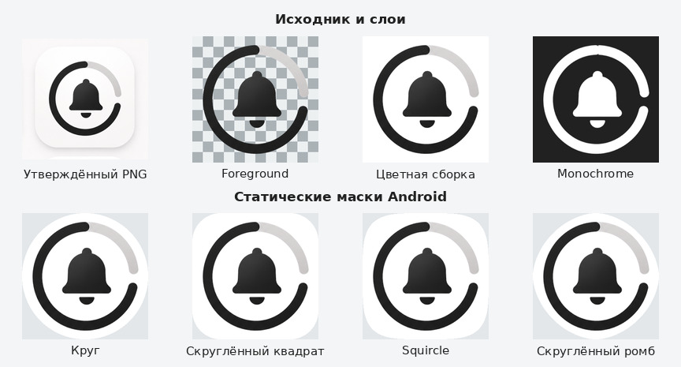

# R8 — Утверждённая иконка приложения

База `codex/r7-final-polish`, SHA `c6eb28ffbc9d682ceae28d67c2b362a0e1f410af`, Draft PR #16. Ветка `codex/r8-launcher-icon` создана непосредственно от принятой ревизии. Коммит проверенных ресурсов и теста `3acf0e4d1ca481ccec3f48520d768495a34f500a`. Контрольные материалы и отчёт добавлены следующим коммитом.

Работа покрывает R-UI-10 и статическую часть T-UI-10 по решению №126. Источник формы и палитры — [утверждённый PNG](../redesign/assets/launcher-approved.png).

## Извлечение знака

Исходник — полностью непрозрачный растр RGBA 541 × 516. На нём проверены разомкнутое кольцо с закруглёнными концами, светло-серый участок, корпус колокольчика и отдельный язычок. SHA-256 оригинала до и после обработки совпал.

- Для извлечения использована внутренняя область белой презентационной плитки. За её пределами остались внешний фон и тень. Внутри области измерена локальная подложка по светлым пикселям вокруг знака.
- Непрозрачные участки взяты из фактического растра. На сглаженных краях прозрачность восстановлена по разнице с локальной подложкой и цветом ближайшего участка знака. RGB и альфа масштабированы раздельно, чтобы цвет белой подложки не попал в полупрозрачный контур. Из результата исключены отдельные пиксели, не связанные с тремя частями знака.
- Одна и та же шкала применена к обеим осям. Ширина и высота границ ненулевой альфы изменились с 313 × 323 до 244 × 251 пикселя. Разница в отношении сторон составляет около 0,32% после дискретизации границы.
- Медианы RGB по непрозрачным областям исходника и слоя составили `(36, 36, 36)` и `(36, 36, 35)` для графита, `(213, 211, 211)` и `(213, 210, 210)` для серого. Переходы оттенков внутри знака сохранены. На полупрозрачной границе максимальное значение канала 236 из 255.

## Слои Android и геометрия

- Растры `drawable-nodpi/ic_launcher_foreground.png` и `drawable-nodpi/ic_launcher_monochrome.png` имеют размер 432 × 432 пикселя. В расчёте геометрии это слой 108 × 108 dp при 4 пикселях на dp. Знак занимает примерно 61 × 62,75 dp. Максимальное расстояние от центра до пикселя с ненулевой альфой — 31,56 dp при радиусе контрольной безопасной области 33 dp.
- Существующий `mipmap-anydpi-v26/ic_launcher.xml` подключает цветной foreground и белый `@android:color/white`. На API 33+ одноимённый XML из `mipmap-anydpi-v33` дополнительно подключает monochrome. Два PNG имеют одинаковый альфа-канал. Android и поддерживающий launcher могут тонировать силуэт для системных тематических иконок. Обычная цветная иконка имеет белый фон при любой теме приложения.
- Для центральной области 72 × 72 dp программно применены круг, скруглённый квадрат, squircle и скруглённый ромб. Для каждой маски проверено пересечение с ненулевой альфой знака. Обрезано **0 пикселей**. Изображения ниже собраны из ресурсов R8 и утверждённого исходника. Маски рассчитаны статически.



## Проверка APK

Build Tools 35.0.0, `aapt2 dump resources`, `xmltree`, `badging` и `permissions`. Проверены оба скомпилированных варианта adaptive icon, разрешение всех ссылок, белая подложка и наличие monochrome в варианте API 33+. Декодированные PNG из APK совпали с исходными ресурсами по всем каналам.

Имя `Подписки`, пакет `com.glebskorobogatov.subscriptiontracker`, launcher activity `com.glebskorobogatov.subscriptiontracker.app.MainActivity`, minSdk 31, targetSdk 36. Расшифровка merged manifest и список разрешений совпали с APK R7. Скомпилированные правила исключения данных Auto Backup/D2D и отдельная иконка уведомлений совпали с R7 побайтно. Конфигурация тестового суффикса `.f04test` и его отдельная подпись сохранены в исходниках.

## Изменённые файлы

- `app/src/main/res/drawable/ic_launcher_foreground.xml` удалён. Вместо временного вектора подключён одноимённый PNG в `app/src/main/res/drawable-nodpi/`.
- `app/src/main/res/drawable-nodpi/ic_launcher_monochrome.png` и `app/src/main/res/mipmap-anydpi-v33/ic_launcher.xml` добавлены для тематической иконки.
- `app/src/main/res/values/strings.xml` и `ScaffoldSmokeTest.kt` обновляют базовую подпись «Менеджер подписок» до «Подписки» и проверяют её через фактическую ссылку manifest.
- `docs/reports/R8.md` и `docs/reports/R8/launcher-comparison.jpg` содержат результаты и статическую визуальную сверку.

## Выполненные проверки

Temurin JDK 21.0.9, Android SDK 36, Build Tools 35.0.0, Gradle Wrapper 8.13.

```sh
git diff --check
./gradlew :app:testDebugUnitTest :app:assembleDebug :app:lintDebug :app:compileDebugAndroidTestKotlin --no-daemon --max-workers=2 --console=plain
```

| Проверка | Результат |
|---|---|
| `git diff --check` | **PASS** |
| JVM | **429 PASS**, 0 ошибок, падений и пропусков по JUnit XML |
| Debug APK | **PASS**, собран и проверен `aapt2` |
| Lint | **PASS**, 0 ошибок, 8 прежних предупреждений |
| Компиляция Android-тестов | **PASS**, 485 методов с `@Test` в скомпилированных классах |
| R-UI-10 / T-UI-10, ресурсы и маски | **PASS**, статическая сверка и аудит APK |
| Android-тесты, запуск и кадры launcher | **NOT RUN**, инструментальная среда недоступна |

В первом прогоне Gradle завершился успешно, однако аудит APK обнаружил отсутствие базового варианта в пакете после переноса XML в `mipmap-anydpi`. Сохранён исходный путь `mipmap-anydpi-v26`. Повторная сборка и аудит подтвердили обе конфигурации. Gradle повторно использовал результаты JVM и компиляции Android-тестов, так как после возврата XML их входы не изменились.

В облачной среде нет бинарника эмулятора и KVM. ADB завершился до вывода списка устройств из-за недоступного служебного каталога. На реальном launcher остаются проверки цветной иконки в обеих темах устройства, подписи «Подписки», масок и тематической иконки на API 33+ при поддержке launcher. Для Android 12 отдельно проверить отображение базового варианта. Отложенные проверки R6a–R7 перечислены в [отчёте R7](R7.md).
